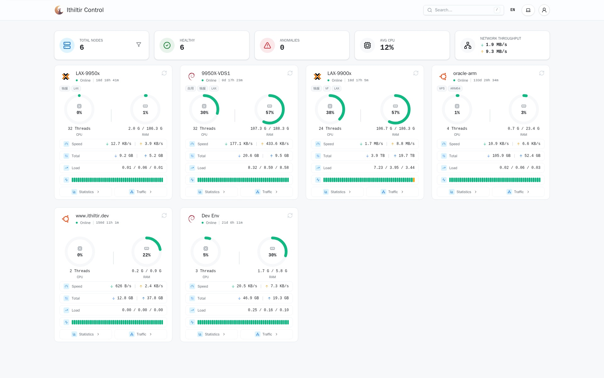

<div align="center">

<h1>
  
  Ithiltir Dash
</h1>

Self-hosted server monitoring dashboard

**[Live demo](https://demo.ithiltir.dev/)** · [Install](#install) · [Features](#features) · [Documentation](#documentation)

[](https://github.com/Ithildur/Ithiltir/releases) [](https://github.com/Ithildur/Ithiltir/releases) [](LICENSE)

**English** · [简体中文](README_CN.md)

</div>

Ithiltir Dash collects server metrics from [Ithiltir-node](https://github.com/Ithildur/Ithiltir-node) and serves the live dashboard, metric history, traffic accounting, alerts, and admin console from a single process.

## Screenshot

<p align="center">
  <a href="screenshot/en.jpg">
    
  </a>
</p>

## Features

- **Live monitoring** · CPU, memory, disk, network, temperature, processes, and connections.
- **History** · Online rates and historical metrics stored in PostgreSQL and TimescaleDB.
- **Hardware and virtualization** · RAID, SMART, NVMe critical warnings, and Proxmox VE host monitoring.
- **Traffic accounting** · Monthly usage, configurable billing cycles, and 95th-percentile billing data.
- **Alerts** · Rules, event history, and notifications via Telegram, SMTP, or webhook.
- **Dashboard administration** · Node groups, search, guest visibility, themes, and system settings.
- **Node deployment** · Managed installation and updates on Linux, macOS, and Windows.

## Install

Dash release packages are available for Linux amd64 and arm64. To install the latest stable release:

```bash
ARCH=amd64
curl -fL -o "Ithiltir_dash_linux_${ARCH}.tar.gz" \
  "https://github.com/Ithildur/Ithiltir/releases/latest/download/Ithiltir_dash_linux_${ARCH}.tar.gz"
tar -xzf "Ithiltir_dash_linux_${ARCH}.tar.gz"
cd Ithiltir-dash
sudo bash install_dash_linux.sh --lang en --service-manager=systemd
```

Use `ARCH=arm64` on AArch64 systems. On supported Debian/Ubuntu systems, the installer can provision dependencies, run migrations, and register the systemd service.

In a [standard production deployment](https://www.ithiltir.dev/en/docs/Install/AllInOne), Dash, PostgreSQL with TimescaleDB, and Redis run on one host behind a local HTTPS reverse proxy.

The installer converts database and role names to lowercase and asks for a different name if PostgreSQL reserves the keyword.

### Connect the first node

After installation, open the configured `app.public_url`; append `/login` for the admin console. Create a node there and follow the generated install command.

<details>
<summary>Optional: Monitor Proxmox VE virtual machines</summary>

Release packages include the helpers for optional PVE VM monitoring; custom packages require `scripts/package.sh --with-pve`.

- **Install** · Copy the PVE installation command from the admin console and run it on the PVE host. The installer enables the helper and gRPC transport; reverse proxies must forward gRPC.
- **View** · Click the host card's PVE system icon to view its VM list. Expand a VM row for details and historical metrics, or use Expand all / Collapse all.
- **Guest access** · Guest access is disabled by default and can be enabled for guest-visible hosts. Guests see only VM lists and current metrics, without IPs; names require explicit opt-in. Details and historical charts are administrator-only.

See [Node deployment](deploy/node/README.md#optional-pve-monitoring) for installation, updates and disabling collection.

</details>

## Documentation

[Documentation site](https://www.ithiltir.dev/en/)

| Document | Contents |
| --- | --- |
| [Quick start](https://www.ithiltir.dev/en/docs/QuickStart) | Install Dash and connect the first node |
| [Installation](https://www.ithiltir.dev/en/docs/Install) | Production deployment, proxies, platforms, and upgrades |
| [Operations](https://www.ithiltir.dev/en/docs/Operations) | Backup, retention, capacity, security, and troubleshooting |
| [Site branding](https://www.ithiltir.dev/en/docs/Config/Themes#site-branding) | Logo, page title and topbar text |
| [Architecture](docs/architecture.md) | Runtime ownership, data flow, storage, alerts, and updates |
| [API](docs/api.md) | HTTP routes and wire contracts |
| [Breaking changes](docs/breaking-changes.md) | Migration and compatibility notes |

## Operational Notes

- Dash is single-instance. Do not run multiple Dash processes against the same state.
- `app.public_url` must be a root URL; path prefixes such as `/dash` are unsupported.
- Use HTTPS outside a trusted network. Browser, API, theme, and deployment paths must remain same-origin.
- Redis stores admin sessions and disposable frontend state by default. With `--no-redis`, both are process-local and reset on restart.
- Back up `$DASH_HOME/configs/notify-config.key` separately from PostgreSQL. Notification credentials cannot be recovered without the matching key.

Storage retention, capacity planning, backup, proxy, and security guidance lives in the [operations documentation](https://www.ithiltir.dev/en/docs/Operations).

### Node gRPC transport

HTTP remains the default for compatibility. Set `ITHILTIR_NODE_TRANSPORT=grpc` (RPC only) or `auto` (negotiate before reports) in the Node service environment, then restart Node. Dash serves gRPC on its existing HTTP/2 listener; proxies must forward `/ithiltir.node.v1.Node/` with gRPC support. These modes never authorize plaintext fallback after authentication or TLS failures. PVE history also requires the root helper service (`pve-cache`). Browser APIs and asset downloads remain HTTP.

### Update

```bash
/opt/Ithiltir-dash/bin/dash update --check
sudo /opt/Ithiltir-dash/bin/dash update
```

The default channel installs stable releases. To select a prerelease, use `--test`:

```bash
sudo /opt/Ithiltir-dash/bin/dash update --test
```

If an interrupted migration requires recovery, run:

```bash
sudo /opt/Ithiltir-dash/bin/dash update recover
```

Read the [breaking changes](docs/breaking-changes.md) before upgrading across versions with migration notes.

## Run From Source

Source development requires Go 1.27.3+, Bun 1.3.11, PostgreSQL 16+ with a matching TimescaleDB build, and Redis unless Dash is started with `--no-redis`.

```bash
cp configs/config.example.yaml config.local.yaml
# Replace the __...__ placeholders before continuing.
export monitor_dash_pwd='<password>'
go run ./cmd/dash migrate -config config.local.yaml
go run ./cmd/dash -debug
```

The admin password must contain at least eight visible ASCII characters without whitespace. See the [quick start](https://www.ithiltir.dev/en/docs/QuickStart) for the full source setup.

## Development

### Tests and checks

```bash
go test ./...
cd web
bun run lint
bun run typecheck
```

Database integration tests require `TEST_DATABASE_URL`.

### Frontend development

The frontend development server can proxy a running Dash:

```bash
cd web
FRONT_TEST_API=http://127.0.0.1:8080 bun run dev
```

### Build the frontend and a Linux package

```bash
bash scripts/build_frontend.sh -o build/frontend/dist
bash scripts/package.sh --with-pve \
  -o release -t linux/amd64 --tar-gz
```

Each target has its own unpacked directory under `release/<os>/<arch>/Ithiltir-dash/`. Archives are written directly to `release/`. The optional `--zip` format requires the `zip` command.

Local Node asset layouts are documented in [deploy/node/README.md](deploy/node/README.md).

## License

AGPL-3.0-only. See [LICENSE](LICENSE).
